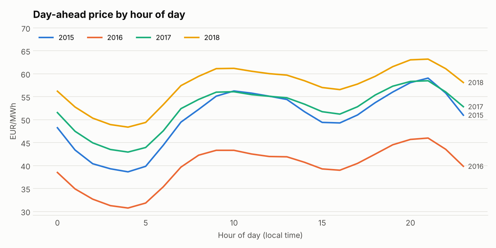
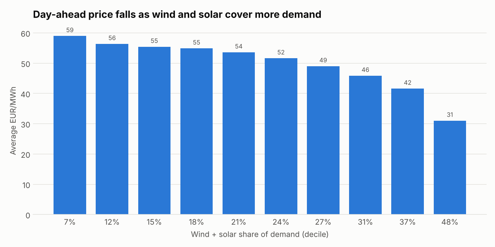
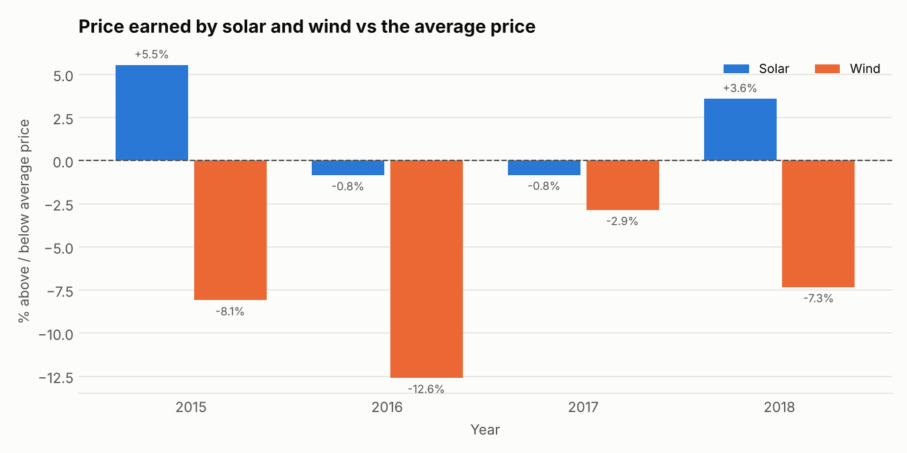
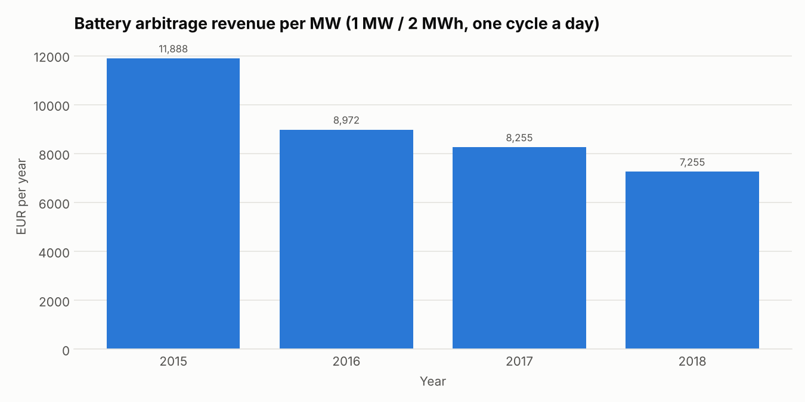
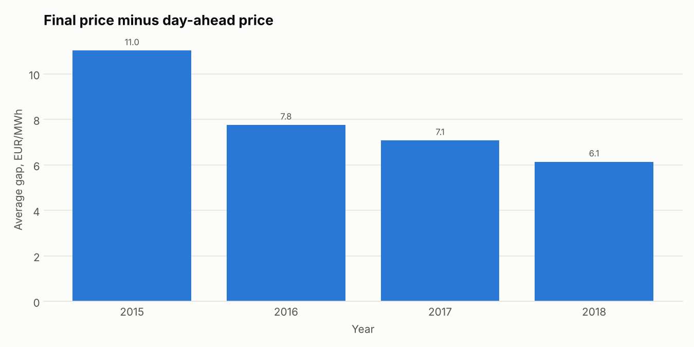
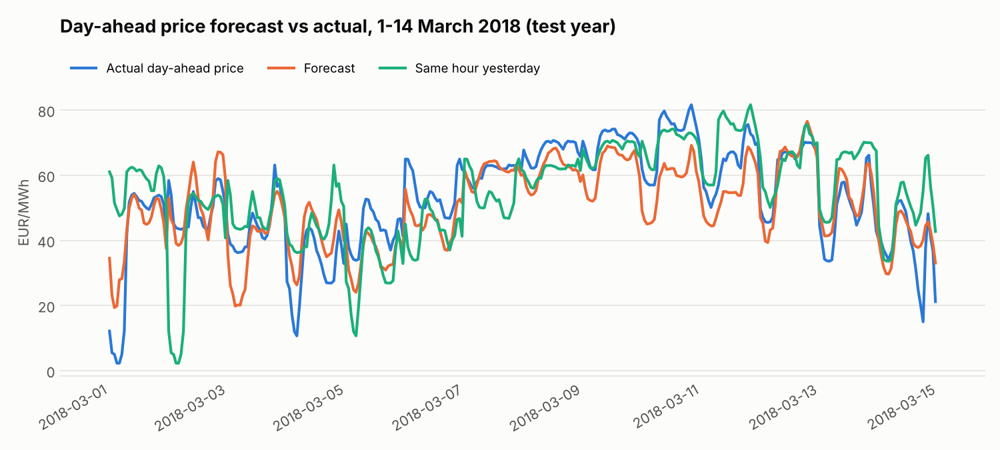

# Spain Power Market: Renewables, Prices and Battery Value (2015–2018)

*Personal project.* An analysis of four years of hourly Spanish electricity data. It looks at when power is cheap or expensive, how wind and solar move prices, what a battery could earn, and how well the day-ahead price can be forecast with information available the day before.

## Business questions

1. When is power cheap or expensive?
2. Do wind and solar push prices down, and what price do they actually earn?
3. What could a battery earn from daily price differences?
4. How accurate are the grid operator's forecasts, and why is the final price above the day-ahead price?
5. How well can the day-ahead price be forecast using only what is known at noon the day before?

## Data

[Hourly energy demand generation and weather](https://www.kaggle.com/datasets/nicholasjhana/energy-consumption-generation-prices-and-weather) (Kaggle). Hourly generation, demand and grid-operator forecasts come from ENTSO-E, prices from Red Eléctrica de España, and weather for Madrid, Barcelona, Valencia, Seville and Bilbao from OpenWeather. The raw data is not stored in this repo; see [`data/README.md`](data/README.md).

Market questions use the **day-ahead price** (the wholesale auction price). The dataset's *price actual* is the final price, which adds system costs, so it is analysed separately (Q4).

## Data quality: what was found and fixed

| Issue | Found | Fix |
| --- | ---: | --- |
| Local timestamps mix CET and CEST offsets | 14,400 / 20,664 rows | Converted to UTC: a clean 35,064-hour series with no missing or repeated hours |
| Energy columns entirely empty or always zero | 8 columns | Dropped |
| Implausible single-hour zeros (nuclear, gas, wind, hydro) | 10 values | Treated as missing |
| Hours with missing energy values | 48 hours | 37 short gaps (≤ 2 h) interpolated; 11 left empty and flagged |
| Duplicate city-hour weather rows (all exact copies) | 3,076 rows | Removed |
| Impossible pressure readings (Barcelona: 0 to 1,008,371 hPa) | 48 rows | Removed |
| Impossible wind speeds (Valencia: 54–133 m/s) | 3 rows | Removed |
| Weather for 5 cities vs demand for the whole country | n/a | Population-weighted national index instead of a plain average |

## Key findings

**Price shape.** The average day-ahead price was 50.3, 39.7, 52.2 and 57.3 EUR/MWh in 2015–2018. Prices are lowest around 04:00 (40.2 on average) and highest around 21:00 (56.7).

**Renewables push prices down.** In the hours with the most wind and solar (48% of demand), the day-ahead price averaged 31.1 EUR/MWh, against 59.0 in the hours with the least (7%). Holding demand, hour, month and year constant, each extra 10 percentage points of wind and solar share is associated with a price 6.3 EUR/MWh lower (R² 0.71).

**Capture prices.** Wind earned 3–13% below the average price every year, because it produces most when it is pushing prices down. Solar earned between 0.8% below and 5.5% above average, because Spain had little solar at the time and it produced during daytime demand. That is the opposite of the market today, where much more solar has been built.

**Battery value.** A 1 MW / 2 MWh battery cycling once a day would have earned 11,900, 9,000, 8,300 and 7,300 EUR per MW from 2015 to 2018. Revenue fell as daily price spreads narrowed (20.5 EUR/MWh on average), and it was highest in January and lowest in June. Arbitrage alone is a thin revenue stream.

**Forecasts and the price gap.** The operator's load forecast was within 1.1% of actual and its solar forecast within 8.5%. The wind forecast was within 3.3% (correlation 0.99), which is suspiciously accurate for a true day-ahead forecast. The final price was above the day-ahead price in 89% of hours, by 8.0 EUR/MWh on average. That reflects system costs, not a trading opportunity.

**Day-ahead forecast.** A gradient-boosting model, retrained each month, forecast 2018 day-ahead prices with an MAE of 5.38 EUR/MWh, **23.5% better** than the "same hour yesterday" baseline (7.02). Trained once and not updated, it under-forecast by 4.6 EUR/MWh on average across 2018, because fuel and carbon costs rose and they are not in the dataset. Without the operator's wind and solar forecasts, the error rises to 6.62.

| 2018 test (8,760 hours) | MAE (EUR/MWh) | vs baseline |
| --- | ---: | ---: |
| Gradient boosting, retrained monthly (chosen on 2017) | 5.38 | −23.5% |
| Same model, trained once on 2015–2017 | 6.80 | −3.2% |
| Same model, without wind/solar forecasts | 6.62 | −5.7% |
| Baseline: same hour yesterday | 7.02 | n/a |
| Baseline: same hour last week | 11.18 | +59.3% |

## Charts

| | |
| --- | --- |
|  |  |
|  |  |
|  |  |

## Method notes

- **No information from the future.** The forecast uses only day-ahead prices already published, the previous morning's system data, the operator's forecasts for the target day and the calendar. It never uses the previous hour's actual price.
- **Fair model choice.** Ridge regression and gradient boosting, each predicting either the price or the price relative to yesterday's average, were compared on 2017 only. The chosen set-up was then run once on 2018.
- **Walk-forward testing.** The model is retrained at the start of each month on all earlier data, as it would be in practice.
- **Battery.** One cycle a day, 88% round-trip efficiency, charging before discharging. Choosing the best hours within a day is realistic because all 24 day-ahead prices are published together.

## Limitations

- 2015–2018 data with little solar, so the solar results do not describe today's market.
- No fuel or carbon prices, which drive much of the price level.
- Simple battery model: no degradation, grid-service income or intraday trading.
- The wind forecast field may not be a true day-ahead forecast, and the price model relies on it.

## Repo structure

```
├── src/
│   ├── clean.py        # loading, validation, cleaning, data-quality report
│   ├── analysis.py     # Q1–Q4
│   ├── forecast.py     # Q5 day-ahead forecast
│   ├── charts.py       # chart styling
│   └── run_all.py      # runs everything
├── notebooks/spain_power_analysis.ipynb   # walkthrough with results
├── results/            # tables (CSV) and summary.json
├── charts/             # PNG charts
└── data/               # raw and processed data (not committed)
```

## How to run

```bash
pip install -r requirements.txt
# put energy_dataset.csv and weather_features.csv in data/raw/
python src/run_all.py
```

This rebuilds `results/`, `charts/` and `data/processed/` (clean hourly and daily tables for Power BI or Tableau).

## Tools

Python (pandas, NumPy, scikit-learn, Matplotlib), Jupyter, Git and GitHub.

## Related work

[mahaqam/europe-power-forecasting-trading-research](https://gh.ali360.cloudns.ch/mahaqam/europe-power-forecasting-trading-research) uses the same dataset for a price forecast that includes the previous hour's actual price. This project instead forecasts the day-ahead price with only day-before information, and adds the market, capture-price and battery analysis.
